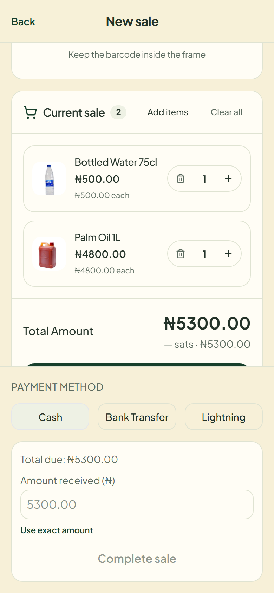
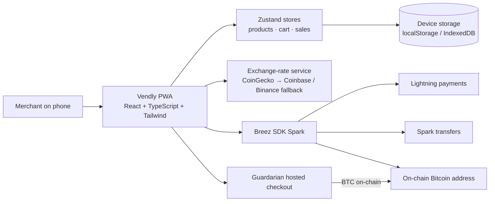

# Vendly

**The point-of-sale and business ledger built for everyday Nigerian merchants.**

Vendly turns a phone into a simple till: record sales in Naira, track stock, take cash or bank transfers, and accept Bitcoin over Lightning — without spreadsheets, notebooks or a separate payment backend.

[](https://react.dev)
[](https://www.typescriptlang.org)
[](https://vitejs.dev)
[](https://sdk-doc-spark.breez.technology/)
[](https://vite-pwa-org.netlify.app/)

---

## Demo video

> **Placeholder — add the final demo video URL here before submission.**
>
> `Demo video: <YOUR_VIDEO_URL>`

The recommended 2–3 minute walkthrough is listed in [Demo workflow](#demo-workflow).

## Screenshot



> If the screenshot has not been added yet, capture the wallet dashboard at 390 × 844 and save it to `docs/screenshots/vendly-dashboard.png`. Do not substitute a mockup.

---

## The problem

A typical Nigerian small merchant runs the business from a notebook, a phone and memory. Sales are recorded inconsistently, stock is discovered to be finished only when a customer asks, and payment records are scattered across cash, transfers and chat messages. At the end of the day there is no reliable answer to three basic questions: **what did I sell, what is left, and how much did I actually make?**

Existing POS tools are often built around card payments and foreign currencies. They assume a formal store, a stable internet connection and a bank integration the merchant may not have. The result is that the smallest businesses — the ones that need the most help — keep using paper.

## The solution

Vendly is a mobile-first, installable PWA that keeps the merchant's daily operation in one place:

- **Naira is the accounting currency.** Prices, sales totals, receipts and reports are stored as integer kobo and displayed in Naira.
- **Bitcoin and Lightning are additional rails, not a replacement.** A merchant can take cash or a bank transfer as usual, or accept a Lightning payment when the customer prefers Bitcoin.
- **No new custody layer.** The wallet runs on the Breez SDK Spark; Vendly does not hold merchant funds or private keys.
- **Works on the phone the merchant already owns.** Large touch targets, a bottom action bar, responsive layouts and an installable app shell.

### Who it is for

- Market and neighbourhood shop owners
- Food vendors and small restaurants
- Salon, tailoring and repair businesses
- Small merchants who want a simple digital sales record without a card terminal
- Merchants curious about Bitcoin payments but not ready to run a full crypto operation

### Local impact

Vendly is designed to make the informal ledger legible. That enables better stock decisions, fewer lost sales and a verifiable sales history that can support access to credit later.

Realistic metrics to track — not claims of current adoption:

- Number of merchants recording at least one sale per week
- Sales recorded and GMV in NGN
- Share of sales by payment method (cash / transfer / Lightning)
- Stock-out incidents and repeated items
- Time from opening the app to completed checkout
- Merchant retention after 4 and 12 weeks

---

## What is implemented

### Products and inventory

- Add products with name, Naira price, stock quantity, barcode and optional photo.
- Edit price, stock, name and photo.
- Delete products with confirmation.
- Photo upload is compressed to a JPEG data URL and persisted, so it survives a refresh; a placeholder is shown when no photo exists.
- Stock is validated when adding to the cart and deducted exactly once after a confirmed sale.

### Point of sale

- Browse the product catalogue from the POS and add items to the cart.
- Barcode entry and camera scanning on supported devices.
- Quantity controls capped by available stock, remove item and clear cart.
- Cash checkout with amount received, live change calculation and exact-amount shortcut.
- Bank transfer checkout with merchant bank details saved on the device and manual confirmation.
- Lightning checkout that generates a real BOLT11 invoice for the cart total and renders it as a QR code, with the live BTC/NGN rate and sats amount.
- Confirmation celebration and a printable-style merchant receipt.

### Sales ledger and reporting

- Confirmed sales only are counted as revenue.
- Sale references such as `VENDLY-…`, timestamps, payment method, line items and totals.
- Cash received and change stored on cash sales.
- Idempotent sale IDs prevent duplicate ledger entries from repeated clicks or duplicate settlement events.
- Daily grouping and all-time totals in Naira.

### Wallet

- Create a new Breez Spark wallet or restore from a 12/24-word BIP-39 recovery phrase.
- Passkey (WebAuthn PRF) access where the authenticator supports it.
- Send and receive Bitcoin over Lightning, Spark and on-chain Bitcoin.
- Receive screen with Lightning, Spark and Bitcoin address tabs, QR codes and copy/share.
- Transaction history with payment details.
- Encrypted recovery-phrase storage; the plaintext phrase is never written to `localStorage`.

### Buy Bitcoin

- A **Buy** action on the wallet opens a Vendly dialog with the merchant's real on-chain Bitcoin address.
- **Continue to Guardarian** opens Guardarian's hosted Bitcoin purchase page for Nigeria in a new tab.
- The merchant copies the address into Guardarian, pays with NGN (or another supported method) and completes Guardarian's KYC.
- Bitcoin is delivered on-chain to the merchant's Vendly wallet address.
- Vendly never receives card details, bank credentials, private keys or recovery phrases, and does **not** mark the purchase complete when the external page opens.

### Platform

- Installable PWA with offline app-shell caching.
- Responsive mobile-first layout and iOS safe-area handling.
- Development-only wallet-free dashboard for exploring Sales and Inventory; always disabled in production builds.

---

## Verification status

The distinction matters for an honest submission.

| Area | Status |
| --- | --- |
| TypeScript, lint, unit tests, production build | Passing (see [Testing](#testing)) |
| Add / edit / delete product, image persistence | Browser-tested |
| Inventory stock updates | Browser-tested |
| Browse Products → cart → cash checkout → receipt → ledger → stock decrement | Browser-tested |
| Bank transfer checkout → receipt → ledger → stock decrement | Browser-tested |
| BTC/NGN live rate and Lightning invoice/QR generation | Browser-tested |
| Buy Bitcoin dialog → real BTC address → Guardarian hosted page opens | Browser-tested on regtest |
| Real Lightning settlement with funds | **Not tested** — requires a second funded wallet and a real payment |
| Real Bitcoin purchase through Guardarian | **Not completed** — would require a funded account and KYC |
| Formal security audit | **Not performed** |

---

## Architecture



**Flow notes**

- Product, cart and sales data live on the device. There is no Vendly server or central merchant database in this MVP.
- Wallet keys are derived and managed by the Breez SDK. Recovery phrases are encrypted with a non-extractable WebCrypto key; passkey wallets derive the key from the authenticator.
- The exchange-rate service never invents a rate: it uses CoinGecko first, then Coinbase × USD/NGN, then Binance × USD/NGN, with a 60-minute hard cache limit.
- Guardarian is an external hosted on-ramp. Vendly supplies a destination address; it does not process the fiat payment or receive KYC data.

---

## Tech stack

- **React 18** + **TypeScript 5**
- **Vite 5** with `vite-plugin-pwa`
- **Tailwind CSS 3**
- **Zustand** with persistence for products, cart and sales
- **Breez SDK Spark** for wallet, Lightning, Spark and on-chain Bitcoin
- **Guardarian** hosted on-ramp for buying Bitcoin with NGN
- **Vitest** + Testing Library; **Playwright** for E2E
- **CoinGecko / Coinbase / Binance** for BTC/NGN rates

---

## Getting started

### Requirements

- Node.js 18+
- npm
- A Breez API key from [breez.technology/sdk](https://breez.technology/sdk/)

### Install

```bash
git clone https://github.com/JemimahEkong/vendly.git
cd vendly
npm ci
cp example.env .env.local
```

Set the required value in `.env.local`:

```bash
VITE_BREEZ_API_KEY=your_breez_api_key_here
```

No Guardarian, MoonPay or other on-ramp API key is required for the Buy Bitcoin flow.

### Run

```bash
npm run dev
```

Open the printed URL, normally `http://localhost:5173`.

Use `http://localhost` (not `http://127.0.0.1`) when testing passkeys: an IP address cannot be a WebAuthn relying-party ID.

### Production build

```bash
npm run build
npm run preview
```

The app is configured for Vercel-compatible SPA rewrites and cross-origin isolation headers in `vercel.json`. For a sub-path deployment set `VITE_BASE_PATH` (for example `/vendly/`).

### Testing

```bash
npx tsc --noEmit
npm run lint
npx vitest run
npm run build
```

Optional Playwright E2E:

```bash
npm run test:e2e
```

E2E wallet tests expect the regtest/faucet environment described in `e2e/`.

Current local results:

- `npx tsc --noEmit` — 0 errors
- `npm run lint` — 0 errors, 2 pre-existing react-refresh warnings in shared UI barrels
- `npx vitest run` — 14 files, 107 tests passing
- `npm run build` — succeeds, PWA service worker generated

### Environment variables

| Variable | Required | Purpose |
| --- | --- | --- |
| `VITE_BREEZ_API_KEY` | Yes | Connects the Breez SDK wallet |
| `VITE_DEV_ACCESS` | No | Enables the wallet-free development dashboard locally; never enabled in production |
| `VITE_STAGING_PASSWORD` | No | Password gate for preview deployments |
| `VITE_PASSKEY_RP_ID` | No | Relying-party ID when sharing passkeys with a parent domain |
| `VITE_BASE_PATH` | No | Sub-path deployment base |

`VITE_*` values are compiled into the client bundle. Never put a secret key, private key or recovery phrase in one.

---

## Demo workflow

A reliable 2–3 minute demo:

1. **Inventory** — add a product with a photo, price and stock. Refresh to show the photo persisted.
2. **POS** — tap **Browse Products**, add the item, show the stock-capped quantity and Naira total.
3. **Cash** — enter an amount above the total, show the change, complete the sale, show the receipt and the decremented stock.
4. **Sales** — open the ledger and show the confirmed sale, Naira revenue and payment method.
5. **Bank transfer** — repeat with saved bank details and manual confirmation.
6. **Lightning** — create a sale, show the live BTC/NGN rate, sats amount, BOLT11 invoice and QR. Explain that settlement is only recorded when the Breez SDK reports the payment.
7. **Buy Bitcoin** — open the wallet, tap **Buy**, show the generated Bitcoin address, copy it, and open Guardarian. Explain that the purchase and KYC happen on Guardarian and the BTC is delivered on-chain to the address shown.

For a testnet demo, append `?network=regtest` and restore the standard Breez test phrase. Never use a real recovery phrase on camera.

---

## Security by design

- **Self-custodial wallet.** Keys are managed by the Breez SDK; Vendly has no server that can move merchant funds.
- **No secret keys in the client.** Only the publishable Breez API key is compiled into the app. No on-ramp secret is used.
- **Encrypted recovery phrase.** Mnemonic wallets are encrypted at rest with AES-GCM and a non-extractable WebCrypto key stored in IndexedDB. Passkey wallets never persist a mnemonic.
- **Input validation.** BIP-39 word count and checksum validation before restoring; numeric validation and stock bounds in the cart; price and stock validation in inventory.
- **Payment confirmation.** Lightning sales are recorded only from Breez SDK settlement events; bank transfers require explicit merchant confirmation; opening Guardarian is never treated as a purchase.
- **Duplicate protection.** Sale IDs are unique and idempotent, a checkout guard blocks repeated submits, and stock is deducted once only after the ledger accepts the sale.
- **Ledger and stock integrity.** Confirmed-only revenue reporting, integer-kobo money handling, all-or-nothing stock deduction.
- **Privacy.** No merchant account, no cloud sync and no analytics in this MVP. Product, sales and bank details stay on the device. Guardarian receives only what the merchant enters on its own checkout.
- **Clear limitations.** No formal security audit has been performed. This is an MVP and should be reviewed before handling meaningful production volume.

### Buy Bitcoin security notes

- Vendly shows the wallet's actual receiving address and warns that it is a Bitcoin on-chain address.
- Users are never asked to paste a seed phrase into Vendly or Guardarian.
- Vendly does not claim that BTC arrived until the wallet observes the funds.
- Guardarian's availability, fees, limits and KYC requirements are set by Guardarian and can vary by region and payment method.

---

## UX/UI quality

- Calm butter-cream and deep-green identity designed for outdoor, high-glare environments.
- Mobile-first layout with large tap targets and a persistent bottom action bar.
- Clear separation between selling, stock, money and settings.
- Naira-first price entry and display; sats are shown only where a Bitcoin payment requires them.
- Product photos with graceful fallbacks.
- Explicit confirmation, loading, empty and error states across checkout and wallet flows.
- Installable PWA shell with offline caching and safe-area support.

---

## Known limitations

- **Lightning settlement is not verified with real funds** in this build. Invoice generation, QR rendering and the settlement watcher are implemented and browser-tested, but a real incoming payment requires a second funded wallet.
- **Buy Bitcoin is an external hosted flow.** Guardarian requires account/KYC steps and supported payment methods. Vendly cannot prefill the address into Guardarian's public page, so the merchant copies it; a partner API key and signed widget session would be required for prefill.
- **MoonPay via the Breez SDK is not used.** The SDK's `buyBitcoin()` backend rejects this project with `PermissionDenied: client certificate required`, which needs provisioning we do not have.
- **No central backend or multi-device sync.** Data is device-local and is lost if browser storage is cleared.
- **Exchange rates are indicative.** A stale rate is labelled, and the hard cache limit is 60 minutes.
- **No formal security audit.**
- **On-chain delivery confirmation is not shown inside Vendly's Buy dialog.** The wallet's normal transaction list and balance reflect received funds after the network confirms them; this path has not been verified with a real purchase.

---

## Next steps

1. Verify a real Lightning settlement and an on-chain deposit on regtest, then mainnet with small amounts.
2. Apply for a Guardarian partner account (or MoonPay publishable key + backend signing) to prefill the BTC address and track purchase status via webhooks.
3. Add a server-side sync layer and merchant accounts for multi-device backup.
4. Add receipt printing/PDF export and daily Z-report.
5. Add supplier and expense tracking, then simple credit-readiness reports.
6. Commission an independent security review before scaling.

---

## Attribution and licence

Wallet and payment rails are powered by the [Breez SDK](https://sdk-doc-spark.breez.technology/). Breez integration and attribution are retained. Bitcoin purchases are fulfilled by [Guardarian](https://guardarian.com/).

Vendly is released under the MIT License. See `LICENSE`. Third-party notices are preserved in `THIRD_PARTY_NOTICES` and `src/LICENSE`.
